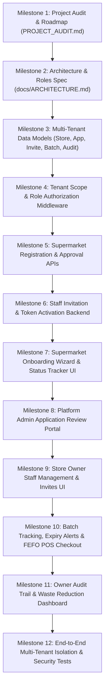

# StoreFlow — Comprehensive Project Audit Report
**Generated on**: October 14, 2026  
**Project**: StoreFlow — Multi-Supermarket Retail SaaS & Smart Inventory Management System  
**Repository**: `c:\Users\user\Downloads\pos-system`  
**Current Git Branch**: `main` (Remote: `https://github.com/Sharmila07106/pos-system.git`)  
**Commit Count**: 68 commits  

---

## 1. Executive Summary

StoreFlow is transforming from a single-supermarket checkout demo into a **production-grade Multi-Supermarket Retail SaaS Platform**.

This audit report verifies the real state of the repository, identifying what exists, what is functional, what is partial or broken, and the step-by-step roadmap to achieve complete multi-tenant isolation, supermarket onboarding, platform administration, staff invitations, and integrated POS/FEFO inventory.

---

## 2. Component-by-Component Audit

### A. Frontend Application
- **Status**: **Partial (Working baseline, needs SaaS multi-tenancy & admin portals)**
- **Technology**: React 19, Vite 8.3.1, Tailwind CSS v4, Framer Motion, Lucide React, Axios.
- **Port**: `http://localhost:5190` (strictPort: true).
- **Existing Working Features**:
  - **Landing Page (`Home.jsx`)**: Branded hero, feature cards, role summaries, responsive navbar, and links to login/POS.
  - **Authentication (`Login.jsx`, `Register.jsx`)**: Split-screen with 3D canvas, client-side validation, password strength meter, JWT token storage, and responsive layout.
  - **POS Checkout (`POS.jsx`)**: Full responsive layout with smooth vertical scrolling across desktop, laptop, tablet, and mobile. Connected to `/api/products` API, displaying accurate product images with category-badge fallbacks, quantity steppers, Cash/Card/UPI payment selectors, cash quick-tender buttons, live change due, and printable paper receipt modal with confetti.
  - **Product Catalog (`Products.jsx`)**: Product listing and modal form for adding/editing products.
  - **Inventory Page (`Inventory.jsx`)**: Stock adjustment tab and stock movements audit table.
  - **Sales History (`SalesHistory.jsx`)**: Order list, filterable transactions, receipt view.
  - **Dashboard (`Dashboard.jsx`)**: Today's sales summary cards and revenue charts.
  - **Profile (`Profile.jsx`)**: Profile details view and password change form.
- **Incomplete / Missing Features**:
  - `Users.jsx` currently uses hardcoded mock state (`const [users] = useState([...])`) instead of real backend staff management.
  - Missing **Supermarket Registration Wizard** (multi-step form collecting business details, owner info, locality, and submitting for approval).
  - Missing **Application Status Page** (allowing applicants to check approval status via reference code).
  - Missing **Platform Admin Portal** (approving, rejecting, or suspending supermarket stores).
  - Missing **Store Context & Tenant Switcher** (displaying current store name, logo, currency, and role permissions).
  - Missing **Batch Management & Expiry Dates** interface in inventory and POS cards.
  - Missing **Audit Log & Waste Tracking** interfaces.

---

### B. Backend Application
- **Status**: **Partial (Core REST API functioning, needs multi-tenant schemas & SaaS routes)**
- **Technology**: Node.js, Express 5.2.1, Mongoose 9.10.3, JSON Web Tokens (JWT), bcryptjs, express-rate-limit.
- **Port**: `http://localhost:5090` (strictPort: true).
- **Existing Working Endpoints**:
  - `GET /api/health` -> `200 OK` (Health status check).
  - `POST /api/auth/register` -> `201 OK` (Public registration with password hashing and JWT).
  - `POST /api/auth/login` -> `200 OK` (Rate-limited authentication with token generation).
  - `GET /api/auth/me` -> `200 OK` (Protected current user info).
  - `GET /api/products` -> `200 OK` (Product catalog with search and category filtering).
  - `GET /api/products/barcode/:barcode` -> `200 OK` (Instant barcode scanner lookup).
  - `POST /api/sales` -> `201 OK` (Checkout endpoint with automated stock deduction).
  - `GET /api/sales` -> `200 OK` (Sales transaction history).
  - `GET /api/inventory/movements` -> `200 OK` (Stock movement logs).
  - `POST /api/inventory/adjust` -> `200 OK` (Manual stock adjustment).
  - `GET /api/settings` -> `200 OK` (Store configuration).
- **Incomplete / Missing Backend Modules**:
  - **Multi-Tenant Models**: Current schemas (`Product`, `Sale`, `User`, `StockMovement`, `Settings`) do not have `storeId` associations.
  - **Missing Models**: `Store.js`, `StoreApplication.js`, `Invitation.js`, `Batch.js`, `WasteRecord.js`, `AuditLog.js`.
  - **Tenant Isolation Middleware**: No server-side enforcement restricting GreenMart employees from querying FreshMart data.
  - **Platform Admin Endpoints**: No routes for reviewing applications, changing store approval status, or listing all registered supermarkets.
  - **Staff Invitation Endpoints**: No secure single-use token invitation and account activation flow.
  - **FEFO Batch Allocation**: POS currently deducts from overall stock instead of allocating batches by First Expired, First Out (FEFO).

---

### C. Database Connection
- **Status**: **Configured with resilient runtime fallback**
- **Details**:
  - `server/.env.example` provides template variables (`PORT=5090`, `MONGODB_URI=`, `JWT_SECRET=`, `CLIENT_URL=http://localhost:5190`).
  - When `MONGODB_URI` is provided, Mongoose connects to MongoDB.
  - In the absence of a live MongoDB Atlas connection or local mongod service, `authController.js`, `productController.js`, and `salesController.js` provide resilient in-memory stores initialized with FreshMart demo data. This guarantees the web app runs smoothly during development and demonstration without throwing unhandled 500 timeout exceptions.

---

### D. Authentication & Role-Based Authorization
- **Status**: **Partial**
- **Existing**:
  - `protect` middleware verifies JWT Bearer tokens.
  - `adminOnly` middleware checks for `role === 'ADMIN'`.
  - Account status check (`status !== 'Disabled'`).
- **Required Enhancements**:
  - Introduce `PLATFORM_ADMIN` vs `STORE_OWNER` / `STORE_ADMIN` hierarchy.
  - Add `requireRole(['STORE_OWNER', 'INVENTORY_MANAGER'])` authorization helpers.
  - Add `storeScope` middleware ensuring `req.user.storeId` matches the requested resource.

---

## 3. Detailed Gap Analysis Matrix

| Feature / Area | Current State | Required Target State | Severity |
| :--- | :--- | :--- | :--- |
| **Multi-Tenancy Isolation** | Single-store data only | Strict `storeId` isolation on every query & record | **Critical** |
| **Supermarket Registration** | Generic single user registration | 5-Step business onboarding wizard & application review | **High** |
| **Platform Admin Role** | Does not exist | Controlled platform admin dashboard & store approval workflow | **High** |
| **Staff Invitations** | Hardcoded mock data in `Users.jsx` | Secure token invitation email/preview & account activation | **High** |
| **Batch & Expiry (FEFO)** | Stock is single integer | Batches with expiry dates, cost, and FEFO POS deduction | **Medium** |
| **Food Waste Tracking** | Not implemented | Waste recording with reason, batch link & waste reduction reports | **Medium** |
| **Audit Log Trail** | StockMovement only | Full audit trail (actor, storeId, action, before/after values) | **Medium** |

---

## 4. Phased Implementation Roadmap

---

## 5. Verification Checkpoints

1. **Backend Verification**: Confirm `server/server.js` starts on port 5090, health endpoint responds 200, and models compile cleanly.
2. **Frontend Verification**: Confirm Vite builds cleanly (`npm run build --prefix client`), and dev server runs on port 5190 with zero console errors.
3. **Tenant Isolation Verification**: Verify that GreenMart users cannot access FreshMart products or sales by testing API responses with different store tokens.
4. **Git Verification**: Create discrete, conventional commits pushed to `origin/main` after each verified step. Keep total commit count tracking transparently.
