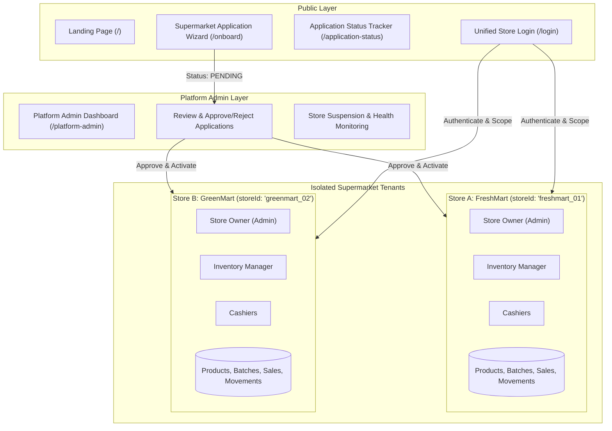
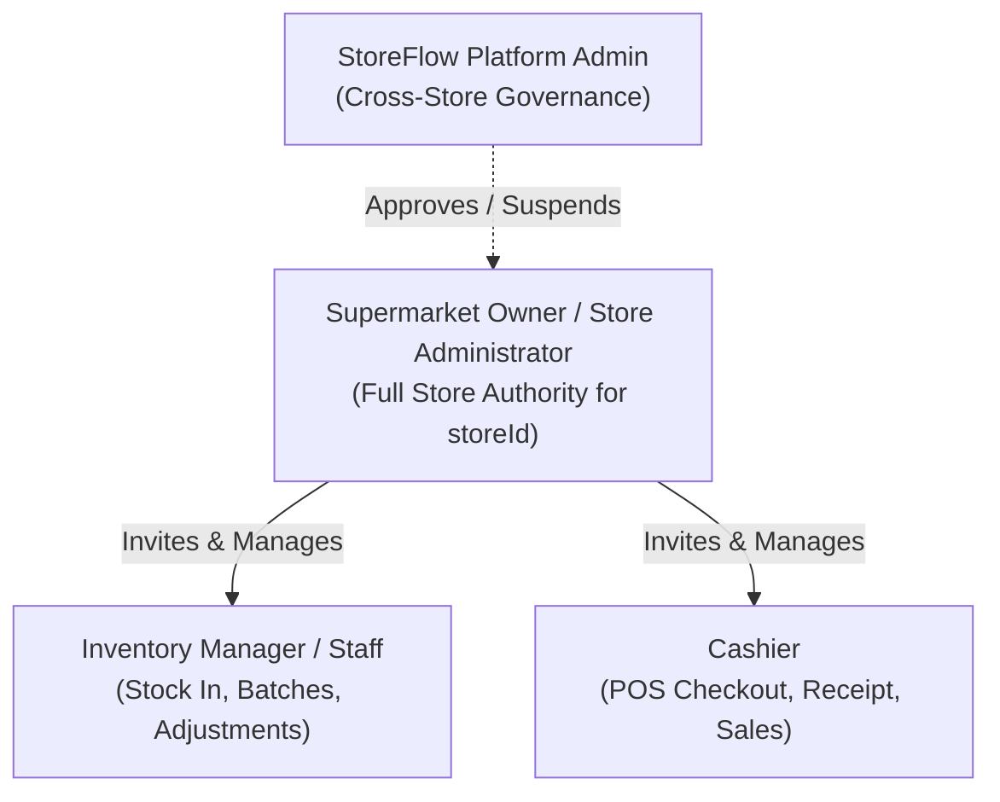
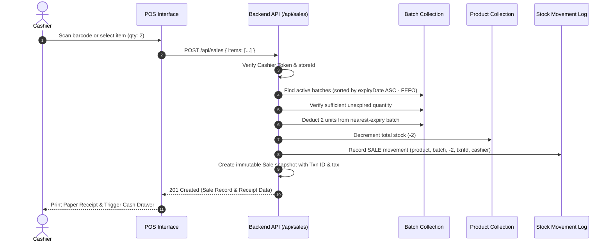

# StoreFlow — Architecture and User Roles Specification

Tagline: **"Smart Checkout. Live Inventory. Less Waste."**  
Platform: **StoreFlow Multi-Supermarket Retail SaaS & Inventory Management System**

---

## 1. System Overview

StoreFlow is a **multi-supermarket retail SaaS platform**. It serves independent supermarkets (such as FreshMart, GreenMart, FreshBasket) on a unified infrastructure while guaranteeing **strict data isolation** and connected POS/inventory workflows.



---

## 2. The Three Core Principles

1. **Approved Supermarkets Only**:
   A supermarket must submit a business registration application. Only after the StoreFlow Platform Administrator approves the application is operational access (POS, staff invitations, inventory) activated. Unapproved, pending, or suspended stores cannot perform sales.

2. **Autonomous Store Control & Tenant Isolation**:
   Each supermarket owner controls their own staff, permissions, inventory, and reports. Every operational record is bound to a `storeId`. Store A staff can **never** view, modify, or leak into Store B data.

3. **Integrated POS and FEFO Inventory**:
   Billing and inventory operate as one single continuous workflow. When a sale completes, the correct batch quantities are automatically deducted using **FEFO (First Expired, First Out)**, inventory movements are logged, and low-stock/expiry alerts update in real-time. Cashiers never manually subtract stock.

---

## 3. Roles and Permission Hierarchy



### A. StoreFlow Platform Admin
- **Scope**: Platform-level oversight.
- **Responsibilities**:
  - View all supermarket applications and registered stores.
  - Review business registration details (business name, owner contact, locality, store type).
  - Approve, reject (with recorded reason), or request changes.
  - Suspend or reactivate approved stores according to compliance policy.
  - Monitor platform operational health and store count without accessing confidential private customer receipts.
- **Security Rule**: Seeded through a controlled environment/database script. Never exposed through public self-registration.

### B. Supermarket Owner / Store Administrator
- **Scope**: Single supermarket (`storeId`).
- **Responsibilities**:
  - Store profile, logo, currency, and tax configuration.
  - Invite staff via email/activation tokens and assign roles (`INVENTORY_MANAGER`, `CASHIER`).
  - Create and manage products, selling prices, and category catalogs.
  - Receive inventory batches with batch numbers and expiry dates.
  - Approve stock adjustments, discounts, and refunds.
  - View all sales history, cashier performance, waste records, and audit trails.
- **Security Rule**: Enforced by server-side query scopes (`{ storeId: req.user.storeId }`). Cannot access another supermarket's records.

### C. Inventory Manager / Inventory Staff
- **Scope**: Inventory operations for their assigned supermarket.
- **Responsibilities**:
  - Create product records (defining what an item is).
  - Receive physical stock shipments and create **Batches** (recording quantity, batch number, cost price, and expiry date).
  - Review near-expiry (e.g. within 7/15/30 days) and low-stock alerts.
  - Record damaged or expired stock in **Waste Records**.
  - Request stock adjustments with mandatory reasons.
- **Security Rule**: Product creation does not automatically fabricate inventory without a verified stock receiving action. Cannot create staff or edit store settings.

### D. Cashier
- **Scope**: High-speed, distraction-free checkout screen.
- **Responsibilities**:
  - Search products by name or instant barcode scanner (F2 shortcut).
  - View live available stock; out-of-stock items are clearly disabled and cannot be sold.
  - Adjust cart quantities within available stock.
  - Select payment tender (Cash with quick chips and live change calculation, Card, UPI).
  - Complete sale with auto-deduction and print itemized receipts.
- **Security Rule**: Cannot modify product prices, cannot manually adjust stock, cannot approve refunds without authorization, cannot create employee accounts.

---

## 4. Multi-Tenant Data Isolation Architecture

To enforce security on the backend, the client's supplied `storeId` is **never trusted blindly**:

1. **JWT Verification**: The token payload contains `{ userId: user._id, storeId: user.storeId, role: user.role }`.
2. **Database Verification**: The `authMiddleware.js` loads the active user from MongoDB, confirming their assigned `storeId` and `status === 'Active'`.
3. **Tenant Query Scoping**:
   All database queries automatically filter by `storeId`:
   ```javascript
   // Example in productController.js
   const products = await Product.find({ storeId: req.user.storeId, isActive: true });
   ```
4. **Platform Admin Segregation**: Platform admin endpoints use `platformAdminOnly` middleware and access platform application collections (`StoreApplication`), not tenant private bills.

---

## 5. Integrated POS & FEFO Inventory Workflow



---

## 6. Staff Invitation & Token Lifecycle

1. Owner submits: `{ name: "Priya", email: "priya@freshmart.com", role: "CASHIER" }`.
2. Backend creates `Invitation` record:
   - `tokenHash`: SHA-256 hash of a cryptographically secure random token.
   - `expiresAt`: 48 hours from creation.
   - `status`: `'PENDING'`.
3. In production, an email is dispatched. In local development, a safe invite preview link is available in the dashboard (`/activate-staff?token=...`).
4. Staff member opens link, verifies email, creates a password, and the account is activated with the owner's `storeId`.
5. The token is marked `'ACCEPTED'` and cannot be reused.
